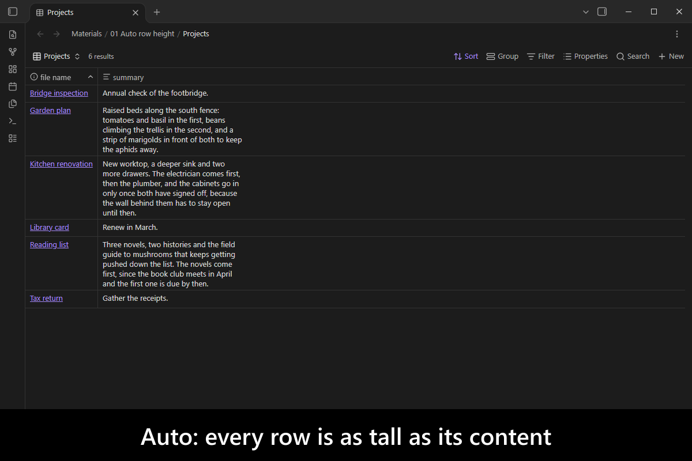
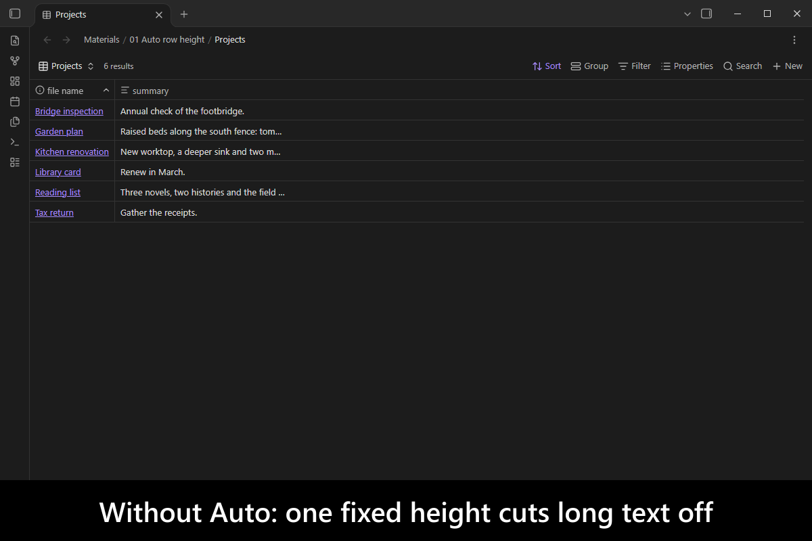

# Bases Auto Row Height

   

Adds an Auto row height to Bases table views, so each row grows to fit its content like a Markdown table.

A Bases table gives every row one fixed height: Short cuts long values off mid-sentence, and Tall wastes space on every short row. **Auto** sizes each row to its tallest cell and wraps long text, while the table keeps working like a table: clicks, selection, the arrow keys and PageUp and PageDown land on the row you see.

<!-- markdownlint-disable MD033 -->

More screenshots

<!-- markdownlint-enable MD033 -->
## Demo vault

**The documentation is a demo vault.** Every feature has a note that explains what it does and why you would want it, with a button you can press to watch it happen.

**[Start reading here](<./demo-vault/00 Start.md>)** — it is plain markdown, so it works on `GitHub` with nothing installed.

A copy of the vault ships with every release. You can access it via any of the following:

1. Running the **`Bases Auto Row Height`: Open demo vault** command.
2. Downloading `bases-auto-row-height-demo-vault.zip` from the [Releases](https://github.com/mnaoumov/obsidian-bases-auto-row-height/releases). It unzips into a single `bases-auto-row-height-demo-vault-<version>` folder.
3. Browsing its source in [`demo-vault/`](./demo-vault/README.md) in this repository.

## What it does

- **Auto row height** for every Bases table view, saved per view as `rowHeight: auto`. [01 Auto row height](<./demo-vault/01 Auto row height.md>)
- **A table that still works like a table**: clicks, selection, the arrow keys, PageUp and PageDown and scrolling follow the real row heights. [01 Auto row height](<./demo-vault/01 Auto row height.md>)
- **Late content followed**: a row grows when an image or other content in it renders after the table.
- **No lock-in**: without the plugin, Obsidian reads `rowHeight: auto` as Short, so the base stays valid.
- **Every setting**, by the key it is stored under, including the `maxRows` cap for large tables. [02 Settings](<./demo-vault/02 Settings.md>)

## See also

[My other Obsidian resources](https://mnaoumov.dev/obsidian/)

| Plugin | Features | How `Bases Auto Row Height` differs |
| --- | --- | --- |
| [`Bases Card Wrap`](https://community.obsidian.md/plugins/bases-card-wrap) | wraps or clamps long property values in Bases card views | Same goal as, for a different view: card views only; this plugin sizes table rows |
| [`Bases Style Enhancer`](https://community.obsidian.md/plugins/bases-style-enhancer) | changes the font size of Bases table views | Unrelated to row height; the two can be combined |
| [`Bases Wrap Text`](https://community.obsidian.md/plugins/bases-wrap-text) | a Wrap Text toggle for Bases table views | Same goal as: it wraps within the fixed Medium, Tall or Extra tall height, so every row stays the same height; this plugin gives each row its own height |
| [`Extended Base`](https://community.obsidian.md/plugins/extended-base) | its own table view with per-column wrap, top-aligned cells, transparent background | Same goal as: a replacement view; this plugin keeps the core table view, its editing and its keyboard model |

Last searched for similar plugins on 2026-11-07.

## Installation

The plugin is not yet listed in [the official Community Plugins repository](https://community.obsidian.md/plugins). Until it is, install it as a beta release.

### Beta versions

To install the latest beta release of this plugin (regardless if it is available in [the official Community Plugins repository](https://community.obsidian.md) or not), follow these steps:

1. Ensure you have the [BRAT plugin](https://community.obsidian.md/plugins/obsidian42-brat) installed and enabled.
2. Click [Install via BRAT](https://intradeus.github.io/http-protocol-redirector?r=obsidian://brat?plugin=https://github.com/mnaoumov/obsidian-bases-auto-row-height).
3. An Obsidian pop-up window should appear. In the window, click the `Add plugin` button once and wait a few seconds for the plugin to install.

## Debugging

By default, debug messages for this plugin (id: `bases-auto-row-height`) are hidden.

If you need to enable them refer to the [documentation](https://mnaoumov.dev/obsidian-lib/guides/debugging/).

## Contributing

Contributions are welcome — see [CONTRIBUTING](./CONTRIBUTING.md) to get set up.

## Support

<!-- markdownlint-disable MD033 -->

<a href="https://www.buymeacoffee.com/mnaoumov" target="_blank">Support this plugin</a>

<!-- markdownlint-enable MD033 -->

### Filing an issue (for AI agents and humans)

Open issues through the [issue forms](https://github.com/mnaoumov/obsidian-bases-auto-row-height/issues/new/choose), not as blank issues.

To report a bug from inside Obsidian, run the **`Bases Auto Row Height`: Report a bug** command. It opens the bug form with the plugin version, the Obsidian version and your operating system already filled in.

Filing from the CLI or the API (`gh issue create --body`, or an AI agent filing for you) skips the form, and `gh issue create --template` cannot load an issue form. In that case, open the matching form in [`.github/ISSUE_TEMPLATE/`](https://github.com/mnaoumov/obsidian-bases-auto-row-height/tree/HEAD/.github/ISSUE_TEMPLATE), copy every field as a `### <label>` heading in the form's order, and fill in each one. Always state the plugin version, the Obsidian version and your operating system.

## License

© [mnaoumov](https://github.com/mnaoumov/)
